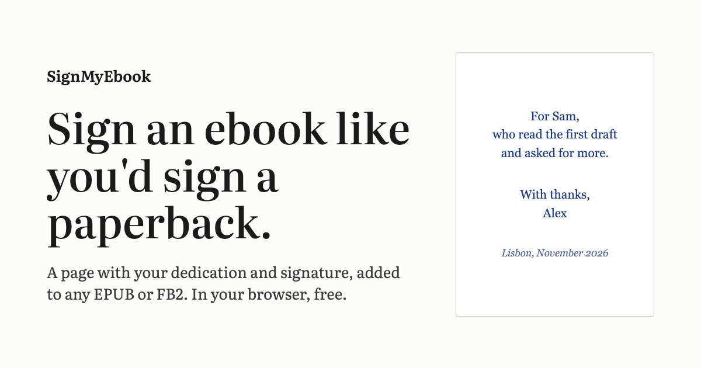

# SignMyEbook

Add a signature page to an EPUB or FB2 ebook, right in your browser.

**Use it at [signmyebook.com](https://signmyebook.com/)**



You choose a book and write a dedication. If you like, you can draw a signature or upload a photo of one, and add a place and date. The tool puts a new page right after the cover and gives you back a signed copy. It all happens on your device: there is no server-side code, and the book is never uploaded.

I made it for authors who want to give signed copies to friends, early readers or supporters. It also works for anyone giving an ebook as a gift.

## Features

- EPUB (2 and 3) and FB2, including `.fb2.zip`
- A dedication in any language or script
- A signature drawn with a mouse, finger or stylus, or uploaded as PNG, JPG or WebP
- A live preview of the exact page that will be added
- Signing an already-signed book replaces the old signature page instead of adding a second one
- Can be installed as a PWA and works offline
- No accounts, no watermarks, no limits, free

## How it works

**EPUB.** The book is opened with [JSZip](https://stuk.github.io/jszip/). The tool reads `META-INF/container.xml` to find the OPF package and adds a new XHTML page (plus the signature image, if there is one) to the manifest. The page goes into the spine right after the first item, which in almost every book is the cover. The page itself is built in [`js/signature-page.js`](js/signature-page.js).

**FB2.** The dedication becomes an `<epigraph>` at the start of the first `<body>`, after the cover image and title. The signature image is stored as a `<binary>`.

In both formats, everything the tool adds gets a `signmyebook-` ID. That's how it recognises its own page when you sign the same book again. Your original file is never changed; every download is a new copy.

## Privacy

The site is a set of static files. Books, text and images stay in the browser tab.

[signmyebook.com](https://signmyebook.com/) counts visits with [Umami](https://umami.is/), a cookie-free analytics tool. Besides page views, it records two events, `Upload Book Started` and `Sign and Download`, each with the file format (`epub` or `fb2`). It never receives the file, its name or anything you write. The script is limited to the `signmyebook.com` domain, so a local copy or a fork sends nothing.

## Running locally

There is no build step and no dependencies to install. The site uses ES modules, so it has to be served over HTTP rather than opened as a file:

```sh
git clone https://github.com/fedorananin/signmyebook.git
cd signmyebook
python3 -m http.server 8000
```

Then open <http://localhost:8000>.

The service worker caches files aggressively. While you're working on the code, turn on **Update on reload** in DevTools → Application → Service Workers, or you'll keep seeing old files.

## Project structure

| File | What it does |
| --- | --- |
| `index.html` | The whole site: the tool and the text below it |
| `styles.css` | All styles, no framework |
| `app.js` | The tool: form handling, format detection, live preview, download |
| `js/epub.js` | EPUB adapter: `loadEpub(file)` and `signEpub(loaded, signature)` |
| `js/fb2.js` | FB2 adapter: `loadFb2(file)` and `signFb2(loaded, signature)` |
| `js/signature-page.js` | Builds the XHTML signature page for EPUB and the preview |
| `js/drawpad.js` | The canvas you draw a signature on |
| `js/image.js` | Resizes and encodes uploaded or drawn signatures |
| `js/landing.js` | Footer year |
| `sw.js` | Service worker (cache-first) for offline use |
| `manifest.webmanifest`, `icon.svg` | PWA manifest and icon |
| `og.html` → `og.jpg` | Source and rendered social preview image |
| `vendor/jszip.min.js` | JSZip 3.10.1 |

### Adding a format

Write a module in `js/` that exports a `load(file)` function and a `sign(loaded, signature)` function returning a `Blob`. Register it in the `ADAPTERS` map in `app.js` and teach `detectFormat()` the file extension.

### Shipping changes

Because the service worker serves files from its cache first, a change to HTML, CSS or JS needs a version bump to reach returning visitors. Keep these numbers the same:

- `?v=N` on `styles.css`, `app.js` and `js/landing.js` in `index.html`
- `CACHE = 'signmyebook-vN'` in `sw.js`
- `?v=N` on the same three files in the `SHELL` list in `sw.js`

## Contributing

Bug reports and pull requests are welcome. If a particular book doesn't sign correctly, please open an issue and mention the reader app you used. Please don't attach copyrighted books.

## License

[MIT](LICENSE). JSZip in `vendor/` is © Stuart Knightley and contributors and is dual-licensed under MIT or GPLv3.

## Author

Made by Fëdor Ananin. Find me on [LinkedIn](https://www.linkedin.com/in/fedorananin/) and [GitHub](https://github.com/fedorananin).
